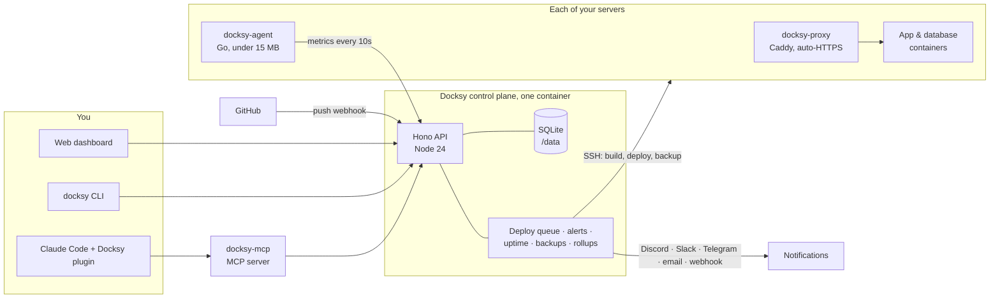

<p align="center">
  
</p>

<h1 align="center">Docksy</h1>

<p align="center"><strong>Deploy to your own servers. It watches them for you, and Claude can fix them.</strong></p>

<p align="center">
  
  <a href="LICENSE"></a>
  
  <a href="https://osmanyousaaf.github.io/docksy/claude.html"></a>
  <a href="https://github.com/sponsors/osmanyousaaf"></a>
</p>

<p align="center">
  <a href="https://osmanyousaaf.github.io/docksy/">Website</a> ·
  <a href="https://osmanyousaaf.github.io/docksy/install.html">Install</a> ·
  <a href="https://osmanyousaaf.github.io/docksy/claude.html">Claude &amp; MCP</a> ·
  <a href="https://osmanyousaaf.github.io/docksy/faq.html">FAQ</a>
</p>

---

Docksy is a free, open-source, self-hosted PaaS, a simpler alternative to Coolify, Heroku and Render on your own VPS. It does three things, and it does them by default:

- **📈 Monitoring on by default.** You get live CPU, memory, disk and network for every server and container, ten preconfigured alert rules, uptime checks and a public status page. Nothing to set up.
- **✦ Claude-native.** A first-party MCP server and a Claude Code plugin let Claude deploy, read metrics, diagnose and fix problems, always with your consent. Docksy itself never calls an LLM: `diagnose` is deterministic, and Claude does the reasoning.
- **🚀 Simple, reliable deploys.** Push to GitHub and it deploys with zero downtime. You also get one-click rollback, one-click databases and backups whose restore is verified automatically.

No paid tiers. No telemetry. No phoning home.

## Install in 2 minutes

On any Ubuntu 22.04/24.04 or Debian 12 server with root:

```bash
curl -fsSL https://raw.githubusercontent.com/osmanyousaaf/docksy/main/install.sh | sudo bash
```

The installer:
1. installs Docker if it's missing
2. generates an encryption secret
3. starts Docksy from `ghcr.io/osmanyousaaf/docksy`
4. registers the host itself as your first server
5. prints the URL

Open `http://<server-ip>:8080`, create the owner account, and deploy. It's idempotent (re-run it to update) and supports `--uninstall`.

Prefer Docker Compose? See [the install docs](https://osmanyousaaf.github.io/docksy/install.html#compose).

## Use it with Claude

Create an API token in **Settings → API tokens**, then:

```bash
export DOCKSY_URL="https://docksy.example.com"
export DOCKSY_TOKEN="dsk_..."
```

```text
# inside Claude Code
/plugin marketplace add osmanyousaaf/docksy
/plugin install docksy@docksy
```

Then just ask:

```text
> deploy this repo to my prod server
> why is prod-1 at 95% memory?
> the api is returning 502s, help
> add postgres for the api with verified daily backups
```

The plugin includes:
- **The MCP server:** 34 tools, plus the deterministic `diagnose`.
- **Commands:** `/docksy:deploy`, `/docksy:status`, `/docksy:diagnose`, `/docksy:logs` and `/docksy:rollback`.
- **Skills:** deploy, diagnose, incident response with a postmortem, server setup, databases, and writing a Dockerfile.
- **The `docksy-sre` subagent.**
- **A safety hook** that always asks before destructive actions.

Want only the MCP server?

```bash
claude mcp add docksy --env DOCKSY_URL=https://docksy.example.com --env DOCKSY_TOKEN=dsk_... -- npx -y @crovenai/docksy-mcp
```

Full tool reference: [Claude & MCP docs](https://osmanyousaaf.github.io/docksy/claude.html).

## CLI

```bash
npm install -g @crovenai/docksy
docksy login https://docksy.example.com --token dsk_...

docksy status                 # fleet overview with bars and sparklines
docksy deploy api --follow    # deploy and stream the build
docksy logs api -f            # follow runtime logs
docksy metrics prod-1 --watch # live, top-like TUI
docksy diagnose api           # deterministic health report
docksy rollback api           # back to the previous good deploy
```

Every read command supports `--json`. See the [CLI docs](https://osmanyousaaf.github.io/docksy/cli.html).

## Docksy vs Coolify

Coolify is an excellent, much more mature project with a far larger catalog, and Docksy owes it a lot. Here's an honest comparison of where each stands:

| Capability | Docksy | Coolify |
|---|:---:|:---:|
| Open source, self-hosted (Apache-2.0) | ✅ | ✅ |
| Git-push deploys, rollback, automatic HTTPS | ✅ | ✅ |
| Server & container metrics | ✅ on by default | ✅ (Sentinel) |
| CPU & memory alerts | ✅ default rules | ❌ |
| Disk usage alerts | ✅ | ✅ |
| Uptime checks & public status page | ✅ | ❌ |
| Scheduled database backups to S3 | ✅ | ✅ |
| Automatic backup **restore verification** | ✅ | ❌ |
| MCP server | ✅ | ✅ |
| Deterministic `diagnose` tool for AI | ✅ | ❌ |
| Claude Code plugin (skills, SRE agent, safety hook) | ✅ | ❌ |
| One-click services catalog | 12 templates | ✅ hundreds |
| Preview deployments, Docker Swarm, many git providers | not yet | ✅ |
| Paid tiers | none, free forever | free self-hosted; optional paid cloud |

This is based on Coolify's public source and docs as of November 2026. If something is wrong, please [open an issue](https://github.com/osmanyousaaf/docksy/issues) and we'll fix it.

## Architecture



| Path | What |
|---|---|
| `apps/server` | Hono API, run directly by Node 24 (type stripping, no build) |
| `apps/web` | React 19 + Vite dashboard |
| `packages/shared` | Shared TypeScript types |
| `packages/client` | `@crovenai/docksy-client`, the typed API client |
| `packages/cli` | `@crovenai/docksy`, the CLI |
| `packages/mcp` | `@crovenai/docksy-mcp`, the MCP server |
| `agent/` | Go metrics agent (static binary, standard library only) |
| `plugin/` | Claude Code plugin |
| `deploy/` | Provisioning scripts run on servers over SSH |
| `docs/` | This website (plain HTML, GitHub Pages) |

## Roadmap

- [x] Zero-downtime deploys from Git, images, compose and templates
- [x] Metrics, default alerts, uptime checks and a status page
- [x] Backups with restore verification
- [x] MCP server, Claude Code plugin and CLI
- [ ] Preview deployments for pull requests
- [ ] More git providers (GitLab, Gitea, Bitbucket)
- [ ] Teams and per-project permissions
- [ ] More one-click templates
- [ ] Log search and retention
- [ ] Multi-node apps and load balancing across servers

Have an idea? [Open a discussion](https://github.com/osmanyousaaf/docksy/discussions).

## Contributing

Contributions are very welcome: code, docs, templates and bug reports. Start with [CONTRIBUTING.md](CONTRIBUTING.md). For security issues, please follow [SECURITY.md](SECURITY.md) and report privately.

## Sponsor

Docksy is free forever and has no paid tier. If it saves you time or money, please consider [sponsoring development](https://github.com/sponsors/osmanyousaaf). ♥

## License

[Apache-2.0](LICENSE) © Crovenai and the Docksy contributors.
