# Docksy: the end-to-end plan

Docksy is a free-forever, open-source, self-hosted PaaS: a simpler Coolify with monitoring on by default and first-class Claude integration. This document is the whole plan, from what we are building to how each screen gets approved. Read it once; then live in [02-SCREENS.md](02-SCREENS.md).

Links: repo `github.com/osmanyousaaf/Docksy` · docs site `osmanyousaaf.github.io/Docksy` · npm `@crovenai/docksy`, `@crovenai/docksy-client`, `@crovenai/docksy-mcp` · image `ghcr.io/osmanyousaaf/docksy`.

## 1. What we are building, and why

Three wedges against Coolify, in priority order:

1. **Monitoring on by default.** Every server and container reports CPU, memory, disk, network and restarts the moment it is added. Alerts, uptime checks and a public status page work out of the box. Coolify has metrics; it does not have alerts and metrics switched on for you.
2. **AI-native, LLM-free.** A first-party MCP server (34 tools), a Claude Code plugin with skills, and a CLI. Claude can deploy, read metrics, diagnose and fix. Docksy itself never calls a model: `diagnose` collects facts; Claude does the reasoning on the user's side.
3. **Simple, reliable deploys.** Push to GitHub and it deploys with zero downtime (new container up and healthy before the old one goes). Rollback in one click, one-click databases, backups with restore verification.

Non-negotiables: no paid tier, no telemetry, no hosted cloud, GitHub-only distribution, grayscale UI.

Who it is for: a solo developer or a two-person team with one to five VPSes who wants Heroku-level ease on their own hardware and wants to know when something breaks before their users do.

## 2. Architecture

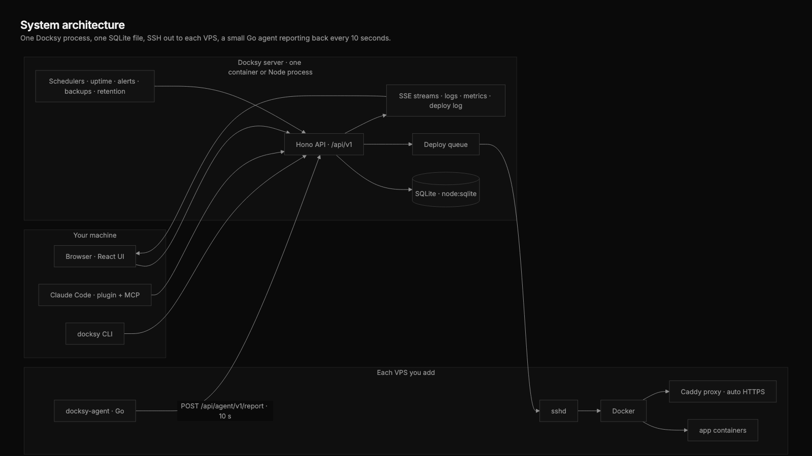

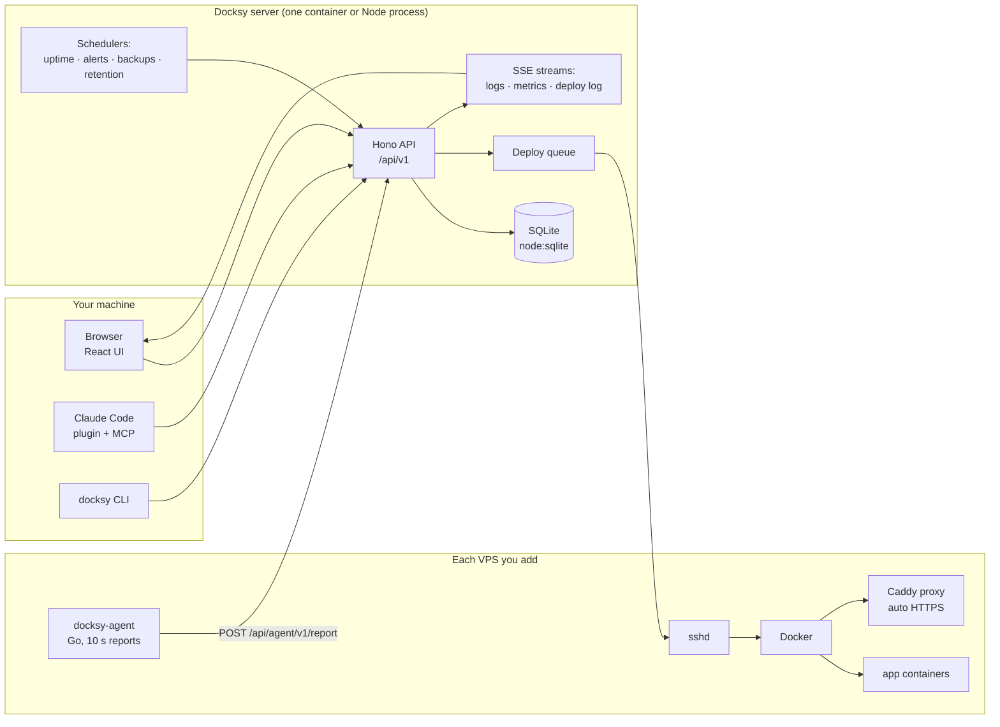

- **One process.** The API, schedulers, SSE and the deploy queue run in one Node 24 process (TypeScript, type-stripping, no build step). State is one SQLite file. Backups of Docksy itself = copy the data dir.
- **Nothing installed on the VPS except Docker, Caddy and the agent.** Docksy talks to the VPS over SSH with its own key; the agent talks back over HTTPS with a per-server token.
- **The agent is Go, stdlib only**, 10-second reports: host CPU/mem/disk/net/load, per-container CPU/mem/net/restarts/state. Built for linux amd64 and arm64 by CI.
- **The browser never talks to the VPS.** Logs, terminal and metrics all go through the API.

### Repository layout

| Path | What | Owner agent |
|---|---|---|
| `apps/server` | Hono API, SQLite, SSH, deploy pipeline, monitoring, alerts, uptime, backups, diagnose | backend |
| `apps/web` | React 19 + Vite + Tailwind 4 + TanStack Query | frontend, ui-ux |
| `packages/shared` | Types only, the contract between server and everything else | backend |
| `packages/client` | Typed HTTP client (used by CLI and MCP) | ai-architect |
| `packages/cli` | `docksy` CLI (commander) | ai-architect |
| `packages/mcp` | MCP server, 34 tools | ai-architect |
| `plugin/` + `.claude-plugin/` | Claude Code plugin, skills, marketplace | ai-architect |
| `agent/` | Go metrics agent | backend |
| `deploy/` | Shell scripts run on the VPS (provision, install agent) | backend |
| `e2e/` | Fake VPS (Docker-in-Docker) and the end-to-end run | qa |
| `docs/` | Static docs site (GitHub Pages) | ui-ux |
| `brand/` | Logo, banners | ui-ux |
| `scripts/` | `dev.sh`, `shot.mjs` (screenshots) | qa |
| `CONTRACT.md` | The API and conventions contract. Code loses to it. | team-lead |
| `coding plan for fable/` | This pack | team-lead |

## 3. Data model

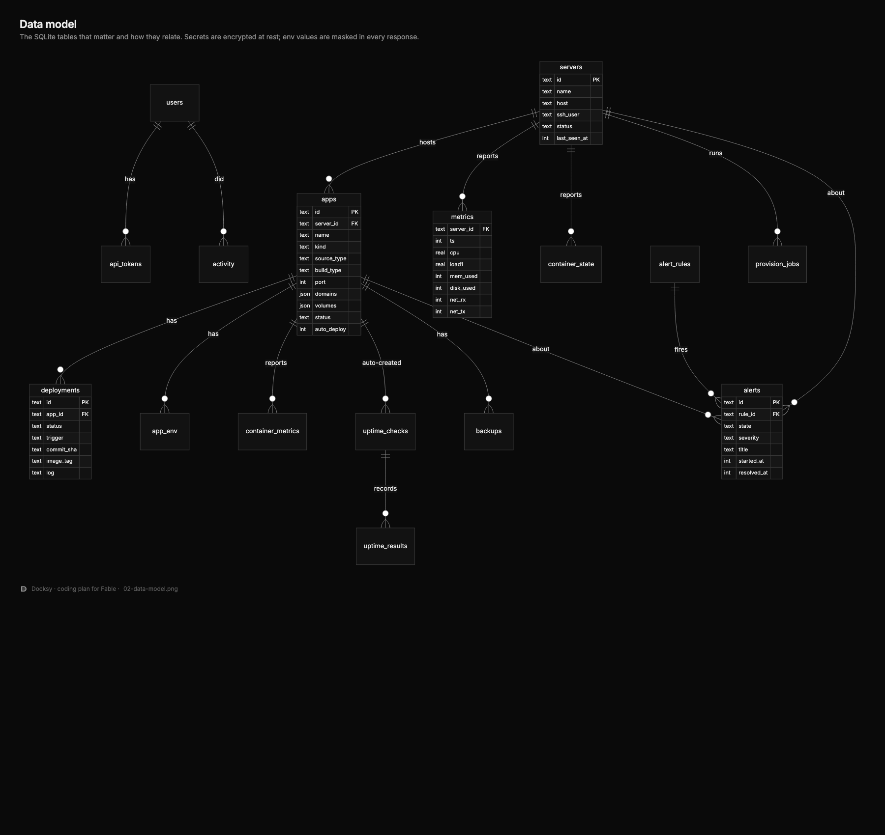

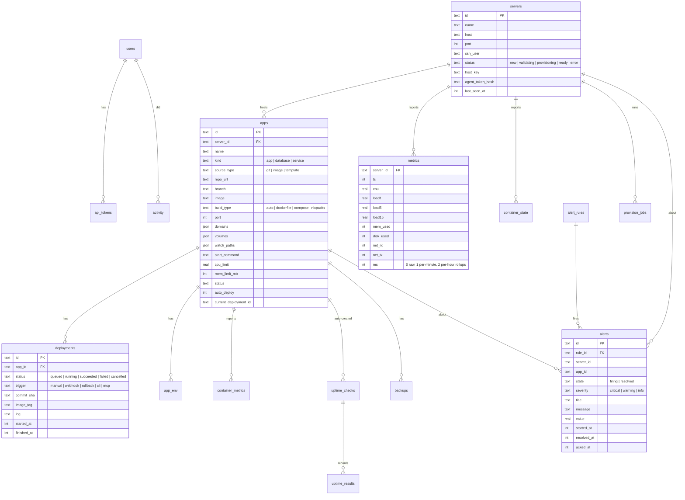

Conventions on every VPS: containers `dx-<app>-<deploy8>`, labels `docksy.managed/app/deployment`, network `docksy`, volumes `docksy-<app>-<name>`, build dir `/var/lib/docksy/builds/<app>/<deployId>`. Secrets are AES-encrypted at rest with a key in the data dir; env values are masked in every response unless `?reveal=1`.

## 4. The three flows that matter

### 4.1 Add a server (S6)

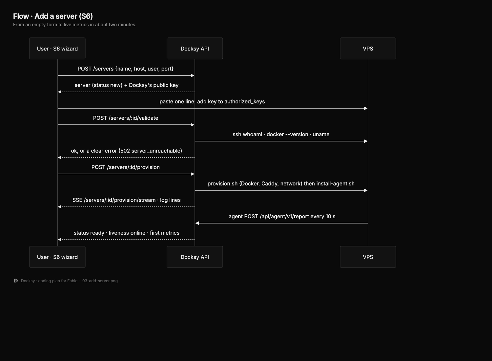

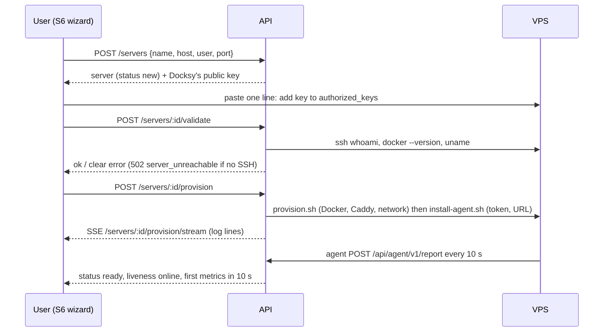

### 4.2 Deploy an app (S9 → S15)

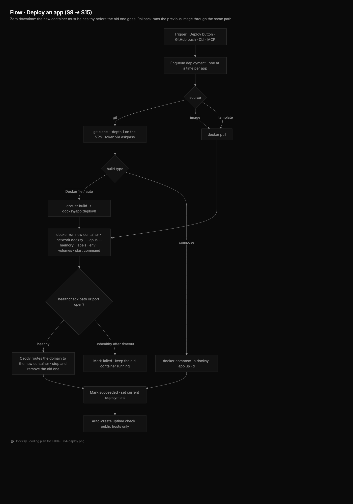

```mermaid
flowchart TD
  T[Trigger: Deploy button · GitHub push webhook · CLI · MCP] --> Q[Enqueue deployment<br/>one at a time per app]
  Q --> S{source}
  S -- git --> G[git clone --depth 1 on the VPS<br/>token via askpass, never on disk]
  S -- image --> P[docker pull]
  S -- template --> P
  G --> BT{build type}
  BT -- Dockerfile --> BD[docker build -t docksy/app:deploy8]
  BT -- compose --> CO[docker compose -p docksy-app up -d]
  BT -- nixpacks/auto --> BD
  BD --> R[docker run new container<br/>--network docksy --cpus --memory<br/>labels, env, volumes, start command]
  R --> H{healthcheck path<br/>or port open?}
  H -- healthy --> SW[Caddy routes domain to new container<br/>stop + remove old one]
  H -- unhealthy after timeout --> F[Mark failed, keep old container running<br/>deployment.finished(failed)]
  SW --> OK[Mark succeeded · set current_deployment_id<br/>deployment.finished(succeeded)]
  OK --> UP[Auto-create uptime check<br/>only for public hosts]
```

Rollback = run the previous deployment's image tag through the same path. Every step is a line in the deployment log (S15), streamed over SSE.

### 4.3 An alert fires (S16)

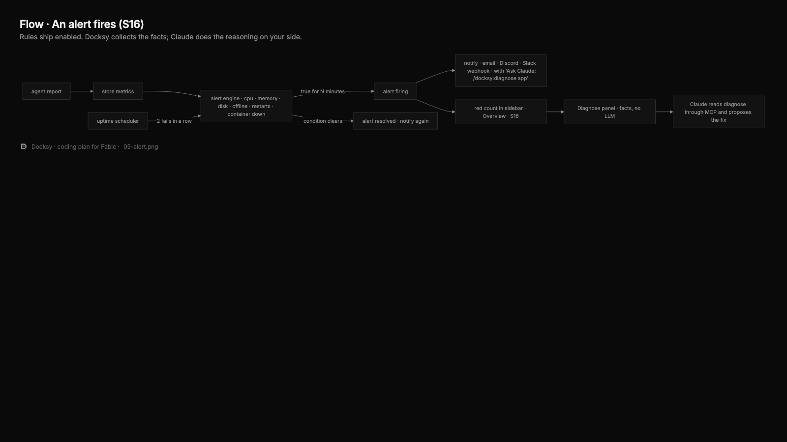

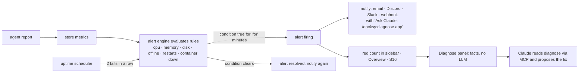

Default rules ship enabled: CPU > 90% for 5 min, memory > 90% for 5 min, disk > 85%, server offline 2 min, container restart loop (5 in 10 min), container down, uptime down. Each can be edited or muted on S16 › Rules.

## 5. The screens

Twenty-one screens, nine app-configuration sections, 66 checks. The full list with every button, API call and check is [02-SCREENS.md](02-SCREENS.md). The map:

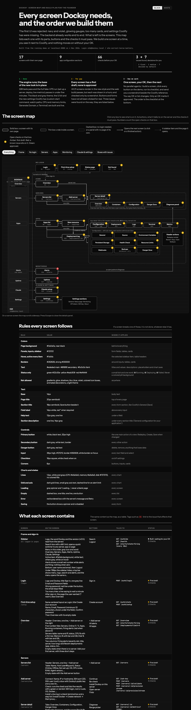

Build order (also the phases below): **frame** (S1–S4) → **servers** (S5–S7) → **apps** (S8–S15) → **monitoring, settings, public** (S16–S21).

How the screens connect:

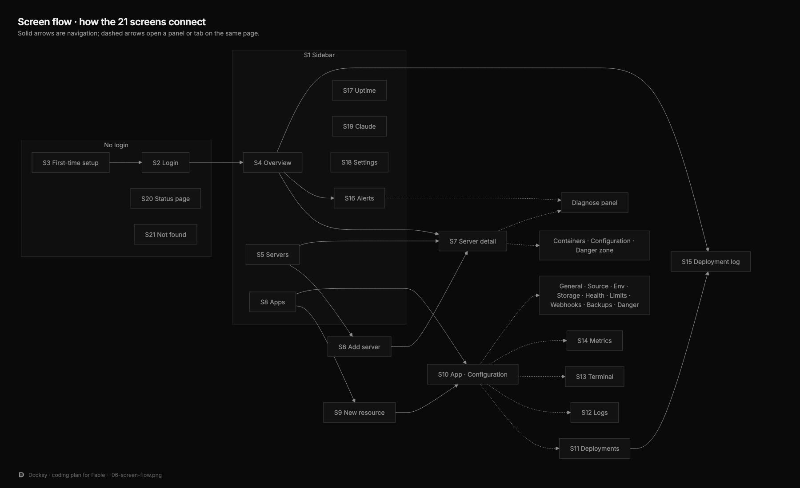

Every screen as it looks today, plus the logo and the diagrams: [04-DESIGN-IMAGES.md](04-DESIGN-IMAGES.md).

What exists now, in the new grayscale style:

| | |
|---|---|
| 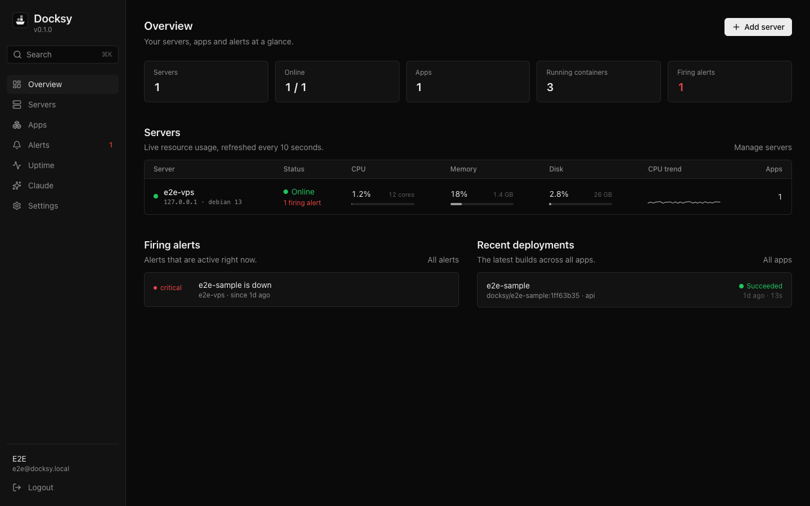 | 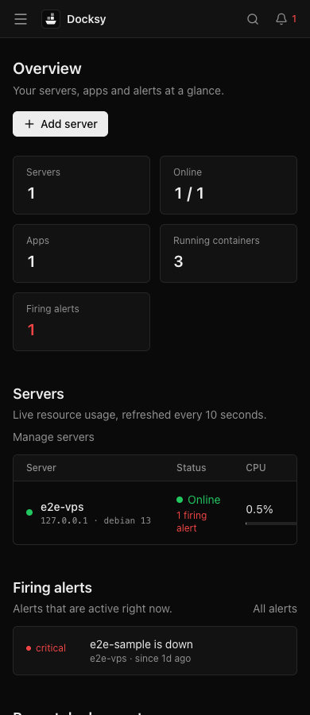 |
| S1 frame with the Overview draft, desktop | S1 on a phone |
| 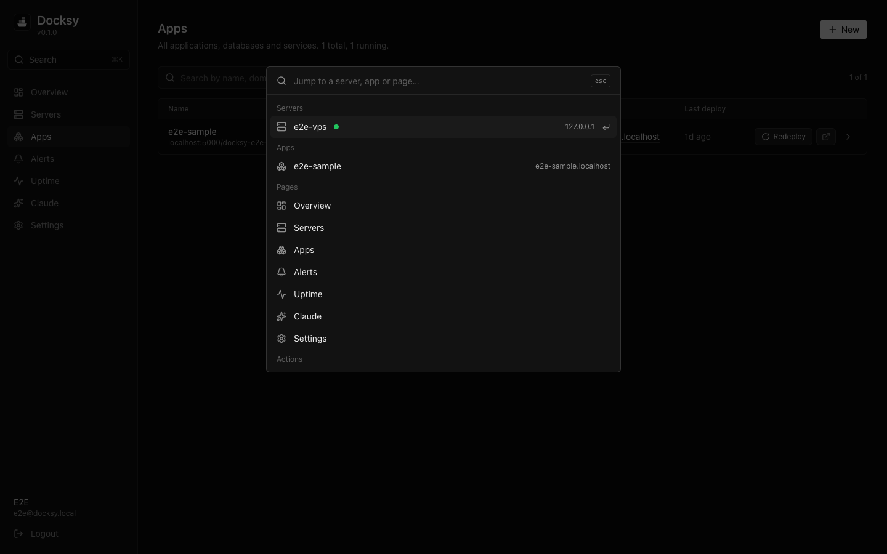 | 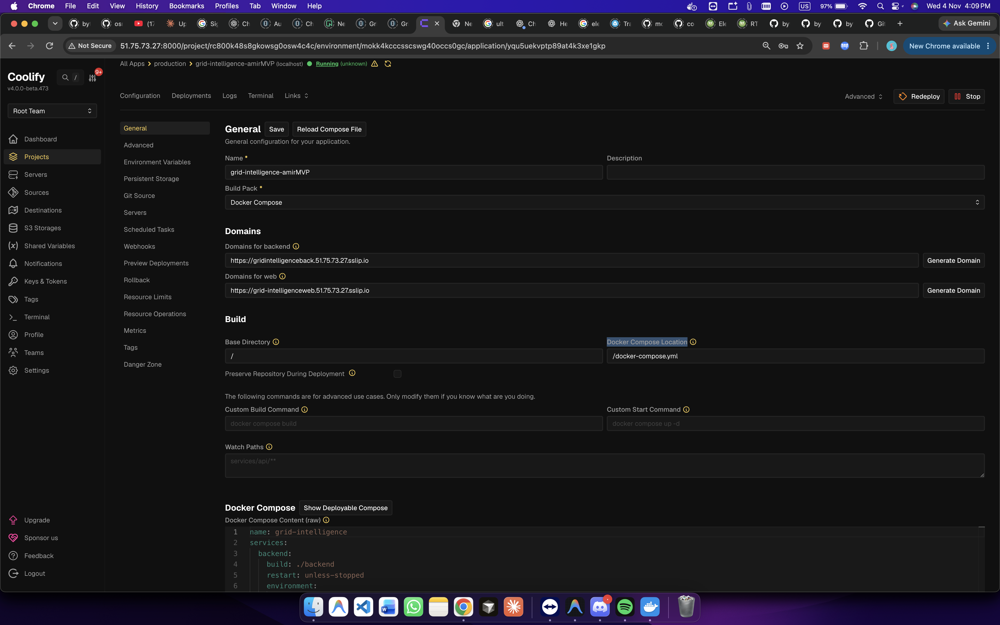 |
| ⌘K quick switcher | The Coolify reference every screen is compared against |

## 6. Design in one paragraph

Black `#0a0a0a` page, `#121212` panels, `#262626` borders, `#ededed` text, `#8f8f8f` muted. Color only for status: green running, yellow deploying, red failed. Inter 14 px. Coolify's page anatomy: breadcrumbs, page tabs, a left sub-nav for configuration, each section titled with its Save button beside it and a one-line description under it. Forms sit on the page, not in cards. No gradients, glows, shadows, blue, violet, light theme or animations. The full rules are in `apps/web/DESIGN.md` and at the end of [02-SCREENS.md](02-SCREENS.md).

## 7. Phases

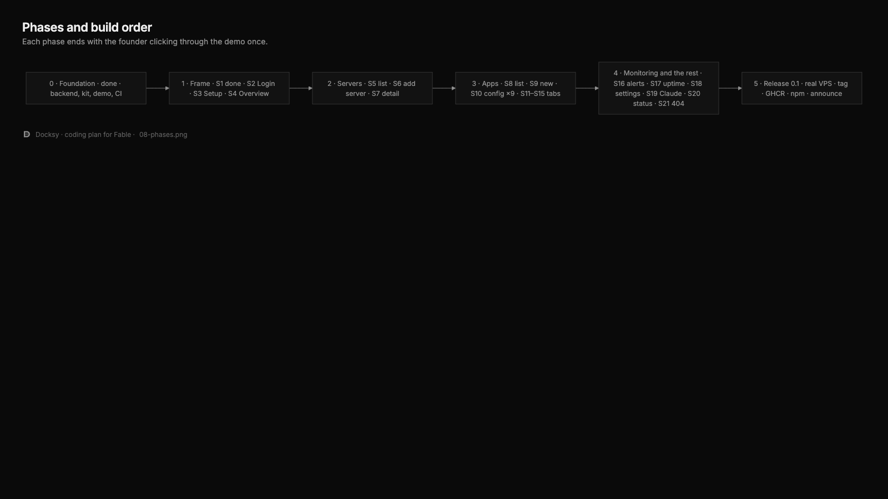

| Phase | Screens | Exit criteria |
|---|---|---|
| **0 · Foundation** (done) | Backend, kit, tokens, demo, screenshot tool, CI | 219 server tests, e2e passes, S1 approved |
| **1 · Frame** | S1 ✅, S2 Login, S3 Setup, S4 Overview | A new user can set up, log in, and see an empty but helpful overview |
| **2 · Servers** | S5 list, S6 add-server wizard, S7 server detail (overview, containers, configuration, danger zone, diagnose) | Add the fake VPS from the browser end to end, see live metrics in 10 s |
| **3 · Apps** | S8 list, S9 new resource (git, image, template), S10 configuration ×9 sections, S11 deployments, S12 logs, S13 terminal, S14 metrics, S15 deployment log | Deploy the sample app from git from the browser, change env and redeploy, roll back, delete |
| **4 · Monitoring and the rest** | S16 alerts (rules, notifications, history), S17 uptime, S18 settings, S19 Claude setup, S20 public status page, S21 404 | An alert fires on the demo and resolves; status page public; Claude plugin installs from S19 |
| **5 · Release 0.1** | Everything approved | `install.sh` on a real VPS works; tag v0.1.0; GHCR image; npm packages; social preview uploaded; announce |

Each phase ends with the founder clicking through the demo once.

## 8. Definition of done (for a screen)

1. Every section, button and state in its `02-SCREENS.md` entry exists and works on the demo.
2. QA report says PASS: suites green, desktop and phone screenshots clean, every button clicked, every form submitted once valid and once invalid.
3. the-user says `OK — Sx approved.`
4. Grayscale, no exceptions. Loading, empty and error (with Retry) states present. 390 px wide works.
5. Status set to `ok` in `02-SCREENS.md`, screenshots in `images/`, one commit named after the screen.

## 9. Risks and open items

| Item | State |
|---|---|
| I1 false "app is down" alert on `.localhost` domains | Fixed 5 Nov: no auto uptime check for localhost / private hosts |
| I2 raw backticks in alert text | Fixed 5 Nov |
| I3 drafts were checked by screenshot only | Addressed by the QA click-through step; `shot.mjs` can now click and press keys |
| Real VPS test | Not yet done; only the fake VPS. Phase 5 |
| Logo | The ribbed D is in use; founder still choosing from the grid of 20 |
| GitHub social preview, Pages source | Social preview must be uploaded by hand in repo Settings; Pages is enabled with the Actions source |
| npm / GHCR publish | Not yet; release workflow exists (`.github/workflows/release.yml`) and runs on a tag |
| GTM doc | Exists at https://claude.ai/artifact/5f8xaByZx1i45HzJuSHWpP; still needs the Docksy name |
