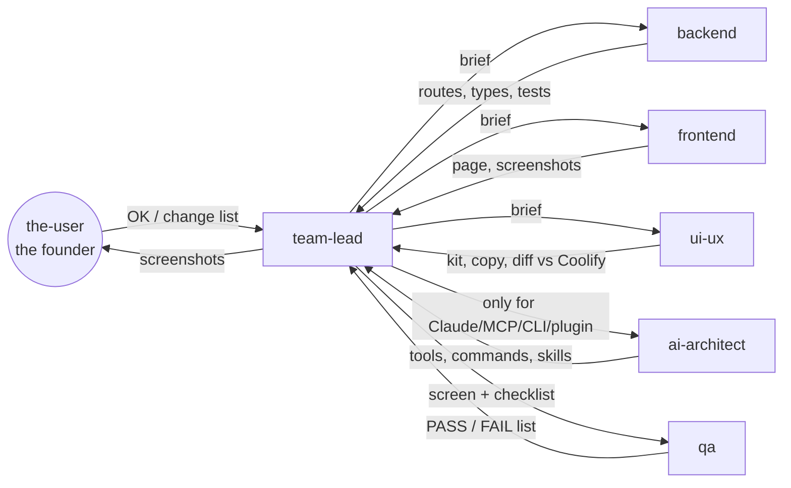

# The team

Seven agents. Five build, one leads, one plays the founder. Each one is a Claude Code agent defined in `../.claude/agents/<name>.md` (copies in [agents/](agents/)). They only know what the team lead puts in their prompt, so every hand-over is written, short and complete.



## Roles and ownership

| Agent | Role | Owns (only these paths) | Must not touch |
|---|---|---|---|
| **team-lead** | Senior team lead. Plans, assigns, reviews, approves, commits. | `coding plan for fable/**`, `.claude/agents/**`, git | Product decisions (asks the founder) |
| **backend** | Server engineer | `apps/server/**`, `packages/shared/src/index.ts`, `deploy/**`, `agent/**` | `apps/web`, CLI, MCP, plugin, package.json |
| **frontend** | React engineer | `apps/web/src/**` except `components/ui.tsx` and `index.css` | Server, kit, tokens, package.json |
| **ui-ux** | UI/UX developer, design system | `apps/web/src/components/ui.tsx`, `apps/web/src/index.css`, `apps/web/DESIGN.md`, `brand/**`, copy | Data fetching, server |
| **ai-architect** | AI principal architect | `packages/mcp/**`, `packages/cli/**`, `packages/client/**`, `plugin/**`, `.claude-plugin/**`, `apps/server/src/monitoring/diagnose/**` | `apps/web` (except S19 copy with frontend) |
| **qa** | QA engineer | `e2e/**`, `scripts/**`, test files it adds | Fixing product code (reports instead) |
| **the-user** | The actual user: the solo founder | Nothing. Reads screenshots, answers OK or a list | Writing code or specs |

One owner per path. If an agent finds a bug in a file it doesn't own, it reports it in its final message and the team lead routes it.

## The loop for one screen

1. **Brief** (team-lead). Copy the screen's block from `02-SCREENS.md` into the prompt. Add: route, demo login, the port each agent should use (backend 8101, frontend Vite 5190, qa Vite 5195), and what is already built.
2. **Build** (backend ‖ frontend, then ui-ux). Backend goes first only if the API is missing from `CONTRACT.md`. Frontend builds every section, button and state. UI-UX compares against the Coolify reference and fixes kit/copy, returns a numbered diff list for frontend.
3. **Verify** (qa). Suites, screenshots desktop + phone, click every button, submit every form, report PASS/FAIL against the checklist.
4. **Review** (the-user). Looks at the screenshots. `OK — Sx approved.` or a numbered list, max 8 items.
5. **Fix** → back to 2 for the items only. Usually one round.
6. **Approve** (team-lead). Status `ok` in `02-SCREENS.md`, screenshots into `images/`, one commit: `S7: server detail approved`.

Time box: if a screen takes more than three rounds, the team lead stops and asks the founder one question with options.

## Hand-over format (every agent ends with this)

```
Screen: S7 Server detail
Changed: apps/web/src/pages/ServerDetail.tsx, apps/web/src/features/monitoring/Charts.tsx
Verified: npm run build -w @docksy/web ok · screenshots /tmp/shots/s7/{root,m/root}.png
Checklist: 4/5 done · open: "Red count on Alerts goes away…" (needs backend: /alerts/:id/resolve doesn't update count)
For others: backend → resolve route; ui-ux → section description copy on Danger Zone
```

## Shared environment

- Demo backend: `http://127.0.0.1:8080`, data in `~/.docksy-demo/data`, fake VPS container `docksy-e2e-vps`. Login `e2e@docksy.local` / `e2e-correct-horse-battery`. Never stop it, never delete its server or app, never change the password.
- Screenshots: `node scripts/shot.mjs <outDir> /route ...` with `DOCKSY_URL`, `DOCKSY_EMAIL`, `DOCKSY_PASSWORD`; options `SHOT_WIDTH`, `SHOT_FULL=1`, `SHOT_CLICK`, `SHOT_KEY`.
- Checks before anyone says done: `npm run typecheck -w @docksy/server`, `npm test -w @docksy/server`, `npm run build -w @docksy/web`; plus the package's own typecheck for CLI/MCP/client when touched.
- Go agent: no local Go; use `docker run --rm -v "$PWD/agent":/src -v docksy-gomod:/go/pkg/mod -w /src golang:1.24 go test ./...`.

## The founder's standing decisions (don't re-ask)

| # | Decision | Chosen |
|---|---|---|
| D1 | Projects/environments or a flat Apps list? | Flat Apps list for v0.1, projects later |
| D2 | Live charts on the server page? | Keep the charts, in gray |
| D3 | Sidebar icons? | Small gray icons |
| D4 | Font? | Inter |
| D5 | Terminal: one command at a time or a real shell? | One command at a time (30 s limit) for v0.1 |
| D6 | Phone support? | Desktop first; phone must not break |
| D7 | How does the founder review? | Screenshots in chat plus the demo open at localhost |
